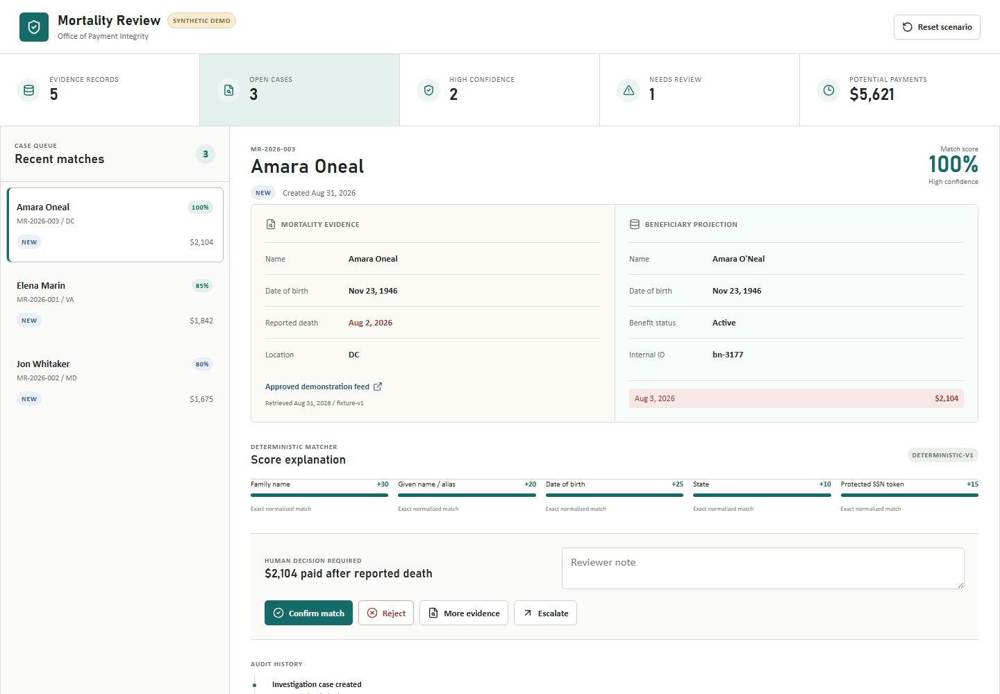
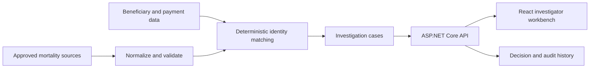

# Mortality Payment Integrity

An investigation-only demonstration for comparing public mortality evidence with synthetic beneficiary and payment records. It creates explainable review candidates for a human investigator; it never changes benefits, initiates recovery, or writes to an agency system of record.

> [!IMPORTANT]
> This repository contains synthetic data only. It is not an eligibility determination system and is not approved for production or use with personally identifiable information.

## Investigator workbench



## Demo workflow

1. Normalize approved mortality evidence and synthetic beneficiary records.
2. Apply deterministic, weighted identity matching.
3. Create cases only when a qualifying match has payment activity after the reported death date.
4. Show every score contribution to an investigator.
5. Record the investigator's decision and an audit event.

The seeded scenario contains five mortality records and produces three review cases. Matching remains deterministic so the same inputs always produce the same explainable result.

## Architecture



The current demo generates all records in memory. The recommended Azure demonstration deployment uses one Linux App Service for the compiled React SPA and ASP.NET Core API, with managed identity, Application Insights, Log Analytics, HTTPS-only access, and a `/health` probe. See [Production evolution](#production-evolution) for the controls needed beyond a demonstration.

## Run locally

Prerequisites:

- .NET SDK 10
- Node.js 24 and npm

Start the API:

```powershell
dotnet run --project src/MortalityReview.Api
```

In another terminal, start the investigator workbench:

```powershell
Set-Location src/MortalityReview.Web
npm ci
npm run dev
```

Open `http://localhost:5173`. Vite proxies `/api` and `/health` to the API at `http://localhost:5042`.

## Build and test

```powershell
dotnet test MortalityReview.slnx
Set-Location src/MortalityReview.Web
npm ci
npm run lint
npm run build
```

Create the combined production artifact from the repository root:

```powershell
dotnet publish src/MortalityReview.Api/MortalityReview.Api.csproj -c Release -o .artifacts/publish
```

The publish target builds the SPA into `wwwroot`, so the deployed app uses one origin and requires no production CORS configuration.

## Deploy to Azure

The validated Bicep baseline creates a Linux App Service B1 plan, App Service, Log Analytics workspace, workspace-based Application Insights, Key Vault, managed identity, and least-privilege Key Vault role assignments. It defaults to `eastus2` and costs approximately `$12.41 USD/month` at the retail rate captured on August 31, 2026, assuming monitoring remains within its ingestion grant.

Review [infra/README.md](infra/README.md) for validation, deployment, application publishing, and cleanup commands. The infrastructure is designed for a synthetic demonstration, not an agency production workload.

## API

| Method | Route | Purpose |
| --- | --- | --- |
| `GET` | `/health` | Liveness check |
| `GET` | `/api/dashboard` | Review queue summary |
| `GET` | `/api/cases` | Ranked case queue |
| `GET` | `/api/cases/{caseId}` | Case detail |
| `GET` | `/api/cases/{caseId}/audit` | Case audit history |
| `PATCH` | `/api/cases/{caseId}/decision` | Record a human decision |
| `POST` | `/api/demo/reset` | Restore the synthetic scenario |

## Safety boundaries

- No automated suspension, termination, overpayment determination, or recovery action.
- No direct write path to an SSA or other agency system.
- No AI-generated identity decision or opaque matching score.
- Every candidate includes human-readable score contributions and source provenance.
- Public-source acquisition must be approved, terms-aware, rate-limited, and auditable.
- Production use requires privacy, records-retention, accessibility, security, and legal review.

## Production evolution

An agency pilot should add Microsoft Entra ID and app roles, Azure SQL for cases and audit history, Blob Storage for governed source evidence, Service Bus for ingestion, Key Vault, private networking, retention policies, and immutable operational audit controls. AI may assist with document extraction, source classification, translation, and investigator summaries, but deterministic rules and human review should remain authoritative for identity matching and benefit action.

See [CONTRIBUTING.md](CONTRIBUTING.md) before proposing changes and [SECURITY.md](SECURITY.md) for vulnerability reporting. Licensed under the [MIT License](LICENSE).